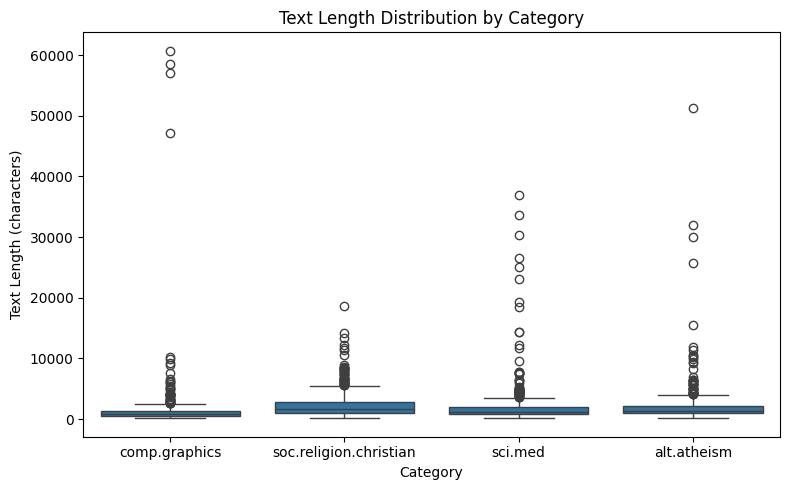
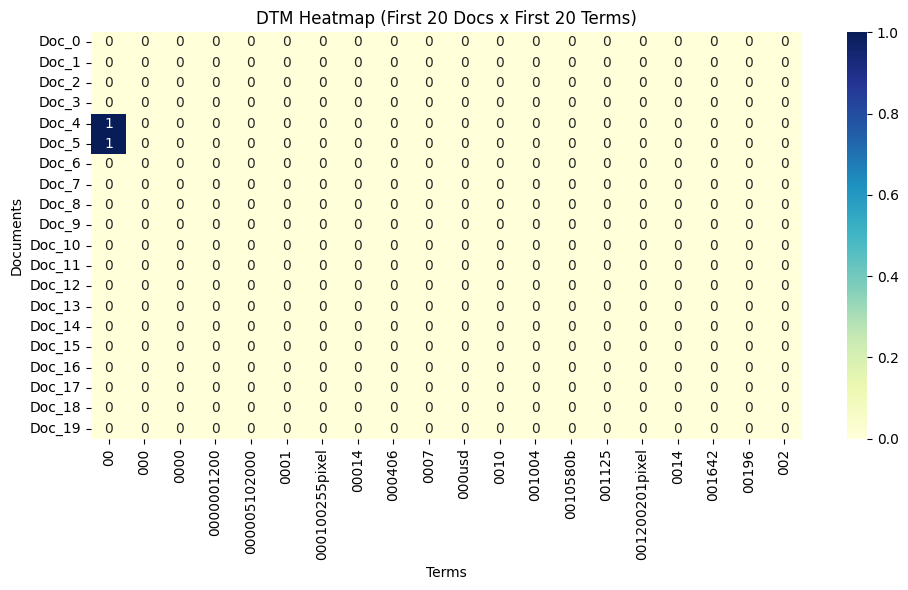
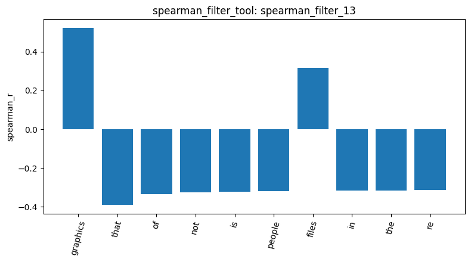
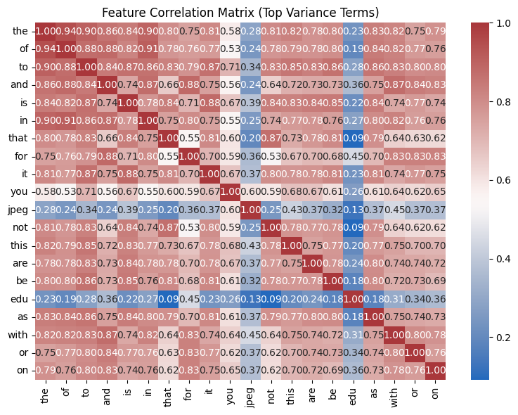
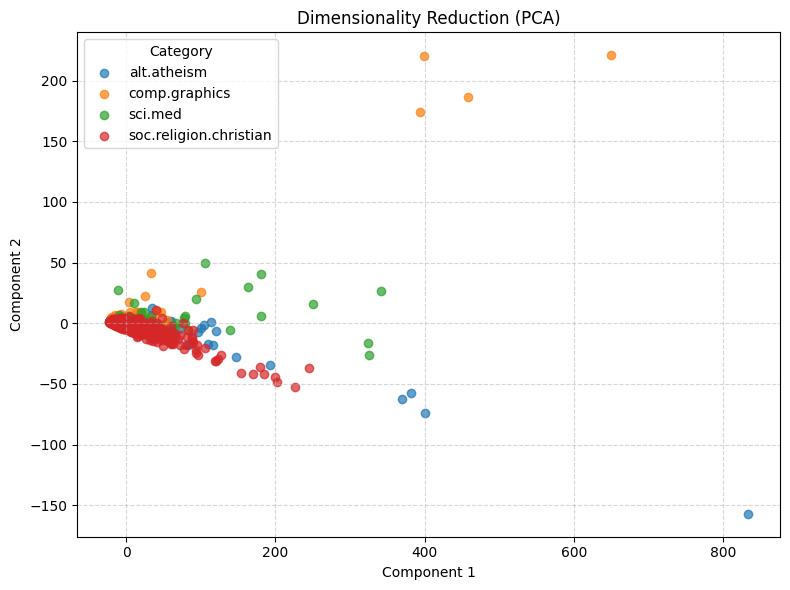
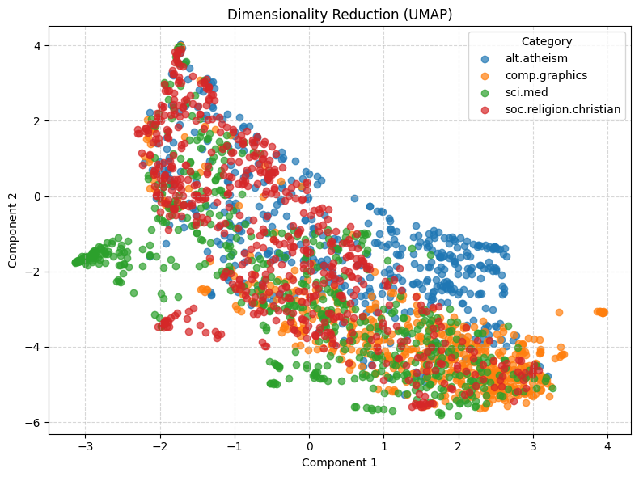

# Agentic Pipeline Report: 20 Newsgroups (4 categories)

The raw newsgroup text still has the email headers in it (`From:`, `Subject:`, `Organization:`, `Lines:`), and those headers affect almost every result below. Term frequencies, class correlations, frequent patterns, PCA and cosine similarity all react to header and writing-style structure more than to topic.

## 1. Data and basic checks

I loaded four categories with `load_dataset_tool` (`load_dataset_1`): 2,257 documents, with soc.religion.christian 599, sci.med 594, comp.graphics 584 and alt.atheism 480. `inspect_data_tool` (`inspect_2`) returned a 2,257 x 3 table (`text`, `category`, `category_name`), and every text starts with a raw header. No text is missing (`missing_3`: 0) and nothing is duplicated (`duplicates_4`: 0 of 2,257). Text length (`describe_5`) is heavily right-skewed: mean 1,993 characters, median 1,235, standard deviation 3,548 (larger than the mean) and a maximum of 60,713 in comp.graphics. A few very long posts can dominate raw counts.

`sample_6` is a reproducible random sample of 5 documents (seed 42).

## 2. Document-term matrix, term frequencies and filtering

`build_dtm_tool` (`dtm_7`) built a 2,257 x 35,788 count matrix with 365,886 non-zero entries, so it is 99.547% sparse. I did not remove stop words. The top 10 terms (`term_freq_8`) are all function words (the 29,825, of 17,660, to 17,222). When I asked for the top 50 (`term_freq_9`), the header words turned up: `from` is 14th (4,877), `edu` 16th (4,675), `subject` 30th (2,464), `lines` 33rd (2,353), `organization` 38th (2,192) and `com` 41st (2,172). The first topical word is `god`, at rank 36 (2,216). The agent had said header words occur only about 2,200 to 2,500 times, but that number did not come from a tool, and `from` is about twice that.

The first 20 columns of the matrix (`dtm_heatmap_10`) are alphabetical numeric tokens like `00` and `000`, so that slice is almost all zeros. It does show how noisy the vocabulary is.

The variance filter with threshold 0.01 (`variance_filter_11`) keeps 5,354 of the 35,788 terms and removes 30,434. A term that occurs in only one document has variance 0.000443, so the threshold roughly means a term has to appear in about 1% of the documents.

## 3. Class correlation and the feature correlation matrix

For comp.graphics, Pearson (`pearson_filter_12`) and Spearman (`spearman_filter_13`) give very different top terms. Pearson's top positive terms are `thanks` (0.278), `keywords` (0.233), `looking` (0.213), `vga`, `video`, `card`, `hi`, `host`, `algorithm` and `nntp`. Only four of those are about graphics. `keywords`, `host` and `nntp` come from header fields, and `thanks`, `hi` and `looking` come from the tone of help requests. Spearman works on ranks and returns topical terms: `graphics` (0.521), `files` (0.317), `image` (0.309), `3d` (0.306), `program`, `file`, `windows`, `ftp` and `format`.

The two top-10 lists share only `thanks` among positive terms and five among negative terms (`that`, `not`, `people`, `re`, `who`). The agent first counted four, and I pointed out the fifth. The bar chart of `spearman_filter_13` is sorted by absolute value, so it mixes `graphics` and `files` with negative function words such as `that`, `of` and `not`. The agent's first text description of this chart listed different terms, so I describe the chart itself here.

The correlation matrix of the 20 highest-variance terms (`featcorr_14`) shows function words moving together (`the` and `of` 0.944, `the` and `in` 0.896). `jpeg` (0.284 with `the`) and `edu` (0.092 with `not`, the lowest pair) behave differently.

## 4. Frequent patterns

I mined comp.graphics (`patterns_15`) and soc.religion.christian (`patterns_16`) with TF-IDF filtering, FP-Growth and a minimum support of 80. comp.graphics has 584 documents, 10,858 surviving terms and 999 patterns. soc.religion.christian has 599 documents, 10,861 terms and 9,699 patterns. In both, the strongest patterns are header words: `lines` and `subject` (support equal to the number of documents, 584 and 599), `organization` (560 and 536) and `edu` (320 and 465), plus combinations of them. These patterns describe the message format, not the topic. `edu` also appears in more christian posts (78%) than graphics posts (55%), which is another header difference.

## 5. Dimension reduction, labels and similarity

PCA (`reduce_pca_17`) puts 65.9% of the variance on the first component and 4.3% on the second. Nearly all documents sit in one blob with a few extreme outliers, and the four categories overlap completely. On raw counts, the first component mostly reflects document length.

UMAP (`reduce_umap_18`) separates the categories only partly. comp.graphics sits mostly at the bottom right, sci.med has a small group on the left, and alt.atheism and soc.religion.christian still overlap a lot. The agent had predicted much cleaner clusters, and the plot does not show that.

`binarize_labels_19` gave a 2,257 x 4 one-hot matrix (counts 480, 584, 594, 599). For cosine similarity, two comp.graphics documents (0 and 1, `cosine_20`) score 0.3532, which is lower than a comp.graphics and a soc.religion.christian document (0 and 4, `cosine_21`) at 0.3738. Raw counts are dominated by headers and function words, so cosine similarity cannot separate topics here.

## Takeaway

The pipeline runs from start to end, but the data needs cleaning first. I would strip the headers and quoted text, drop stop words, and use TF-IDF or length normalization before filtering, mining patterns, reducing dimensions or comparing documents. I expect the topic structure that Spearman and UMAP hint at to come out more clearly after that, but I did not run a cleaned version.
