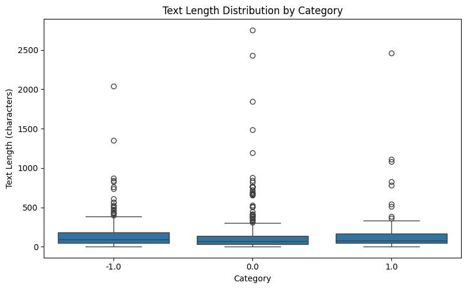
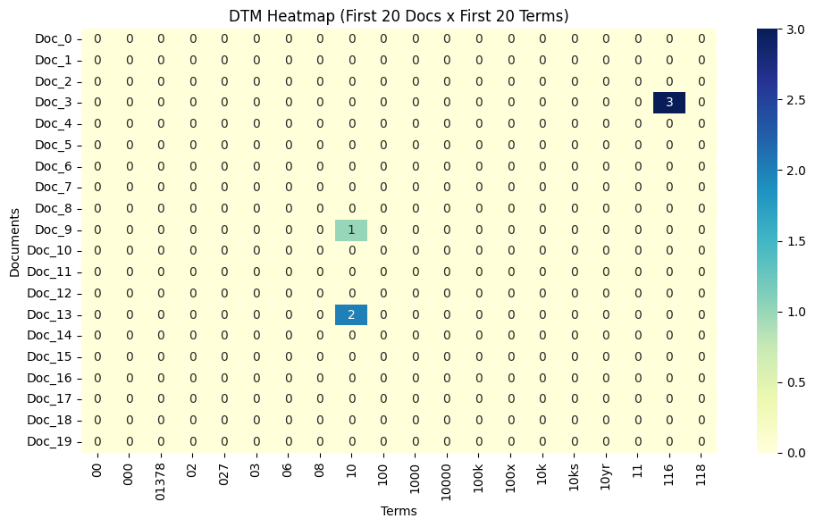
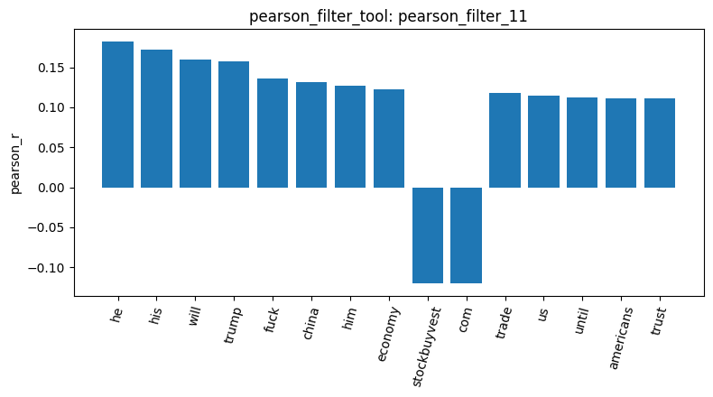
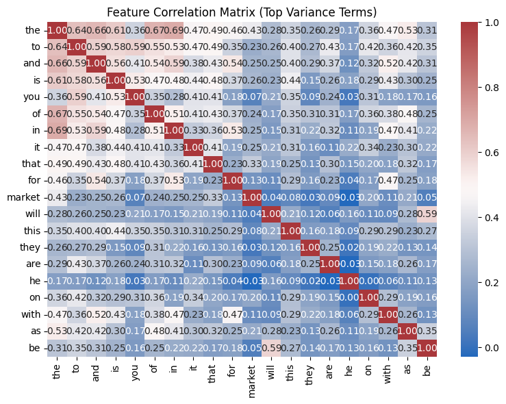
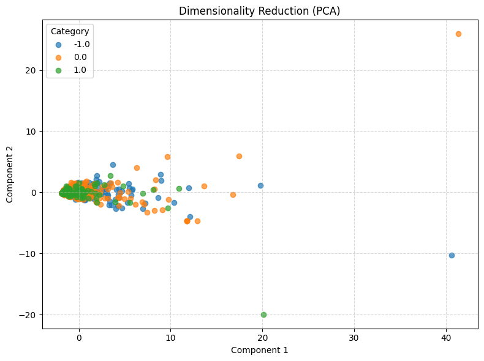
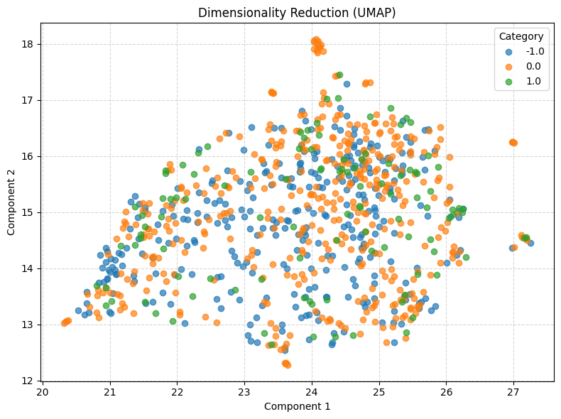

# Homework Report: Reddit Stock Sentiment (3 classes)

I ran the same eighteen tools on `newdataset/Reddit-stock-sentiment.csv`: 847 short Reddit posts and comments about stocks, labeled negative (`-1.0`), neutral (`0.0`) or positive (`1.0`). The tools ran on this data without any change. The results need careful reading, though: the posts are short, the classes are unbalanced, and a few link posts from one site leak into the counts, correlations and patterns. Where I write "checked outside the agent", the number comes from a separate script run on the CSV, not from a tool result in the chat.

## 1. Data and basic checks

`load_dataset_tool` (`load_dataset_1`) loaded 847 posts: 423 neutral, 315 negative and 109 positive. `inspect_data_tool` (`inspect_3`) returned an 847 x 3 table (`text`, `category_name`, `category`), where the codes 0, 1, 2 stand for `-1.0`, `0.0`, `1.0`. `check_missing_tool` (`missing_4`) found no missing text. `check_duplicates_tool` with `drop=False` (`duplicates_2`) found 23 duplicate rows, where the 20 newsgroups data had none. Checked outside the agent, those duplicates involve 34 rows in total (32 neutral, 2 positive, no negative), so dropping them with `drop=True` would leave 813 rows, not 824, because the tool uses `keep=False` and removes every copy. I kept the duplicates and left the data unchanged.

Two labels look doubtful to me. Row 0, "Calls on retards", is labeled negative although buying calls is bullish, and row 2, "Seeing lots of red in the ticker", is labeled neutral although red means falling prices. The loaded data only has text and label, so the agent could not say how the labels were made.

Text length (`describe_5`) is short and right-skewed: mean 148.68 characters, median 79, standard deviation 240.70 and a maximum of 2,753. The median length per class is 96 (negative), 68 (neutral) and 82 (positive). In the box plot all three boxes are squeezed at the bottom, with many outliers above them.

`sample_data_tool` (`sample_6`) returned five random posts (indices 296, 519, 240, 601, 578). I did not pass a `random_state`, so the sample changes on every run and cannot be reproduced.

## 2. Document-term matrix and filtering

`build_dtm_tool` (`dtm_7`) built an 847 x 4,346 count matrix with 17,193 non-zero entries, so it is 99.53% sparse. Stop words are kept. Checked outside the agent, 74.7% of the terms appear in at most two posts. The top ten terms (`term_freq_8`) are all function words: the 920, to 566, and 488, is 402, it 350. Two posts become all-zero rows because they contain nothing but slashes (rows 300 and 798).

The first 20 columns (`dtm_heatmap_9`) are alphabetical number tokens such as `00` and `10`, so only three cells are non-zero (`116` in Doc_3, `10` in Doc_9 and Doc_13). This slice says nothing about the data. It only reflects how the columns are ordered.

The variance filter with threshold 0.01 (`variance_filter_10`) keeps 506 of the 4,346 terms and removes 3,840. The ten removed terms in the preview all have variance 0.001179, which is the variance of a term that appears once in 847 posts. The tool only flags terms, it does not change the matrix. The agent confirmed this when I asked, so PCA, UMAP and the correlation steps below still use all 4,346 terms.

## 3. Class correlation

For the negative class, Pearson (`pearson_filter_11`) gives these top positive terms: he 0.182, his 0.172, will 0.160, trump 0.157, fuck 0.136 and china 0.132. The most negative are stockbuyvest and com (both -0.120), always (-0.103) and updated (-0.096). Spearman (`spearman_filter_12`) gives a similar list: he 0.204, will 0.184, his 0.172, trump 0.161 and fuck 0.144, plus `the` (0.130) and `until` (0.127) as new entries. Pronouns probably rank high because posts about a person (trump, he, his) are often labeled negative. Checked outside the agent, 66% of the 86 posts containing `he` are negative, against 37% in the whole data.

`stockbuyvest` and `com` have exactly the same correlation because they occur in the same 21 posts, all of them links to stockbuyvest.com (20 neutral, 1 positive, 0 negative). So these two terms reflect one website, not sentiment. The agent explained the identical values correctly. When I asked why `the` reaches the Spearman top ten but not the Pearson one, the agent blamed large counts in neutral and positive posts. That does not match the data: the highest count (34) is in a negative post, and `the` appears in 52% of negative posts against 36% of neutral ones.

The bar chart (`visualize_result_tool` on `pearson_filter_11`, plot `turn102`) shows the 15 terms with the largest absolute Pearson value, not the 15 most positive. That is why `stockbuyvest` and `com` sit in the middle of the positive terms.

The correlation matrix of the 20 highest-variance terms (`featcorr_13`) is mostly function words, with `the` and `in` highest (0.694), then `the` and `of` (0.673). `he` is close to zero with everything. The agent said `he` and `they` are slightly negative (-0.029) and repeated this after I pointed to the plot. I dumped the stored matrix: `he`/`they` is +0.0164, and -0.0290 belongs to `he`/`are`, the next column. The agent read the wrong column.

## 4. Frequent patterns

`mine_patterns_tool` (TF-IDF, FP-Growth, minimum support 10) ran on two classes. The negative class (`patterns_14`) has 315 posts, 1,589 terms and 30 patterns, headed by trump 45, just 42, china 33, like 25 and think 23. The neutral class (`patterns_15`) has 423 posts, 2,023 terms and 47 patterns, headed by market 37, like 36, just 31, trump 23 and china 22. Unlike the newsgroup results, these are real topic words, because pattern mining removes stop words itself. The tool returns only ten of the patterns, so I cannot say whether the rest include multi-word patterns. I used a minimum support of 10 because the classes are small (109 to 423 posts); the agent warned that values above 100 would likely return nothing.

The neutral list also shows `com` 20, `stockbuyvest` 20 and the pair [`stockbuyvest`, `com`] 20. These are the same link posts as above, 20 of them neutral, so I would not read them as neutral opinions.

## 5. Dimension reduction, labels and similarity

PCA (`reduce_pca_16`) explains 27.00% of the variance on the first component and 4.99% on the second. The three classes overlap in one blob on the left with a few far outliers, the farthest being the longest post (row 87). Checked outside the agent, the first component has a correlation of 0.944 with the number of words in a post, so it mostly measures post length. UMAP (`reduce_umap_17`) spreads the points out but still does not separate the classes. It has several small tight clumps. Identical posts do land on top of each other, so some clumps may be duplicates, but I did not confirm that these clumps are those. The agent cannot see the plots, and it still described the clumps as promotional links, which I treat as a guess.

`binarize_labels_tool` (`binarize_labels_18`) gave an 847 x 3 one-hot matrix with counts 315, 423 and 109, and each row sums to 1. For cosine similarity, two short posts (0 and 1, `cosine_19`) score 0.0 because they share no word. Two long negative posts (148 and 224, `cosine_20`) score 0.6337. Checked outside the agent, the same pair scores 0.0361 once English stop words are removed, so the high value comes from `the`, `is`, `to` and `of`. Across all post pairs, the average similarity is 0.0682 within a class and 0.0689 across classes, so this matrix shows no sign that same-class posts are closer.

## Takeaway

All steps ran on the Reddit data. The problems I found are in the data itself: the posts are very short, the positive class is small, 23 rows are duplicates, and about 21 link posts distort the counts, correlations and neutral patterns. PCA and UMAP show no class structure, and the high cosine value is a stop word effect. Before comparing classes I would remove duplicates and link posts, drop stop words and use TF-IDF or length normalization, but I did not run a cleaned version. I also found that the agent can state wrong numbers with confidence (the `he`/`they` correlation), so I checked its figures against the stored results.
